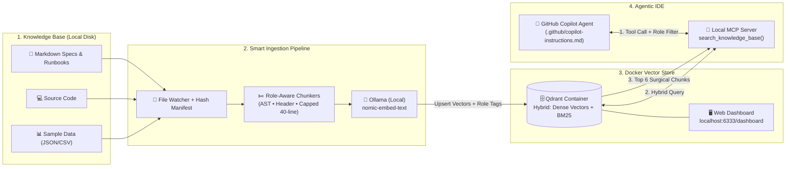

---
tags:
  - ai-engineering
  - rag
  - mcp
  - copilot
  - innovation-demo
status: draft
---

# Local Hybrid-RAG + MCP vs. Standard File Pointing

> [!abstract] Core Thesis
> The contrast between a local vector/keyword architecture and standard file-pointing comes down to **proactive architectural retrieval vs. manual context stuffing**. Pointing an agent at raw folders forces it to guess which files matter, read them sequentially, and burn through its context window.

---

## 1. Context Window Precision (Signal vs. Noise)
* **Standard Approach ("Tell it where to look"):** Pointing Copilot at a folder with 50 feature specs, runbooks, and sample payloads forces the agent to read entire files or rely on basic grep/filename matching. A single 2,000-line sample JSON file or massive architecture doc can consume half the LLM’s active context window—causing **"context rot"** where the model forgets instructions or hallucinates details buried in the middle.
* **Local Hybrid-RAG + MCP:** AST and Markdown-header chunking slices the knowledge base into atomic, self-contained concepts. Instead of ingesting three 10-page documents, the agent pulls only the 6 surgical snippets (function definitions + matching spec paragraphs) it needs.

> [!quote] Demo Talking Point
> *"Instead of dumping entire folders into the prompt and hoping the LLM finds the needle in the haystack, our agent retrieves only the exact 500 tokens of relevant architecture and error history—keeping responses faster, sharper, and hallucination-free."*

---

## 2. Semantic + Exact-Match Discovery
* **Standard Approach:** Telling the agent where to look assumes **you already know the file name or folder** where the answer lives. If a teammate wrote a troubleshooting note under `misc/sprint-4-notes.md` describing a weird timeout bug, standard file-pointing misses it completely unless explicitly linked.
* **Local Hybrid-RAG + MCP:** Hybrid search (**Dense Vectors + BM25 Keyword**) bridges both worlds:
  * **Conceptual queries** (*"How do we handle retry backoffs?"*) match semantically even if the doc calls it *"exponential circuit breaking."*
  * **Exact strings** (`ERR_SSL_049`) lock onto the exact code or log across thousands of files in milliseconds via BM25.

> [!quote] Demo Talking Point
> *"The agent doesn't need to be told which file to open. It understands intent—mapping natural language feature ideas to existing code patterns and obscure troubleshooting logs automatically."*

---

## 3. Role-Aware Guardrails & Data Hygiene
* **Standard Approach:** Raw folders treat everything equally. A mock CSV file with 10,000 rows of dummy user data carries the same weight to a basic file reader as a core authentication spec.
* **Local Hybrid-RAG + MCP:** Tagging chunks by role (`documentation`, `code`, `sample_data`) and capping sample payloads at ingestion enforces **structured reasoning**. Custom `.github/copilot-instructions.md` rules force the agent to check architectural specs *first*, code patterns *second*, and sample data *only* when building tests.

> [!quote] Demo Talking Point
> *"We didn't just give the AI raw files—we gave it an engineered memory. It knows the difference between a source-of-truth requirement, production code, and mock test data."*

---

## 4. Zero-Leakage Local Sovereignty & Reusability (MCP)
* **Standard Approach:** Relies on cloud-side indexing or manual copy-pasting per chat session, locked inside a single proprietary tool.
* **Local Hybrid-RAG + MCP:** Running **Ollama + Qdrant** locally via Docker ensures **zero proprietary code or internal specs ever leave the laptop** for indexing. Exposing the index via **MCP (Model Context Protocol)** decouples the knowledge base from any single IDE—allowing GitHub Copilot, Claude Code, Cursor, or custom CLI agents to plug into the exact same local brain instantly.

> [!quote] Demo Talking Point
> *"It’s 100% air-gapped on local hardware, updates automatically in the background as files change, and uses the open MCP standard so any AI tool on the machine can share the same institutional memory."*

---

## Live Demo Execution Plan
1. **Left Screen — Qdrant Dashboard (`http://localhost:6333/dashboard`):** Display the live vector clusters and metadata tags (`documentation`, `code`, `sample_data`) to visualize the structured memory.
2. **Right Screen — VS Code (Copilot Agent Mode):** Prompt the agent to **implement a new feature or debug an obscure error** *without mentioning any file names*.
3. **The "Aha!" Moment:** Highlight the **MCP tool call firing in real time**—pulling a spec from one folder, a code pattern from another, and an old bug fix from a third—synthesizing them into working code in a single shot.

---

## System Architecture

